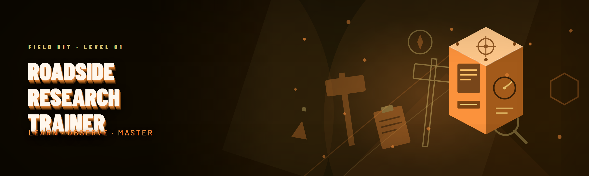

  
  
  

  

  
  

---

## 🧭 Table of Contents

- [Is it safe to run on my machine?](#-is-it-safe-to-run-on-my-machine)
- [System Requirements](#-system-requirements)
- [Compatibility — Does it work on Steam?](#-compatibility--does-it-work-on-steam)
- [Usage Guidelines — Allowed vs Not Allowed](#-usage-guidelines--allowed-vs-not-allowed)
- [Community & Support](#-community--support)
- [Quick Start — Extract and Run in 4 Steps](#-quick-start--extract-and-run-in-4-steps)
- [How It Works — Under the Hood](#-how-it-works--under-the-hood)
- [Comparison — Save Editor vs Trainer](#-comparison--save-editor-vs-trainer)
- [Module Catalog — Core Research Modules](#-module-catalog--core-research-modules)
- [Module Catalog — Roadside Encounter Modules](#-module-catalog--roadside-encounter-modules)
- [Module Catalog — Vehicle & Route Modules](#-module-catalog--vehicle--route-modules)
- [Module Catalog — Survey & Documentation Modules](#-module-catalog--survey--documentation-modules)
- [Module Catalog — Quality-of-Life & UI Modules](#-module-catalog--quality-of-life--ui-modules)
- [Tips for Best Results](#-tips-for-best-results)
- [What Changed in the 2026 Build](#-what-changed-in-the-2026-build)
- [Will It Get Me Banned?](#-will-it-get-me-banned)
- [FAQ](#-faq)

---

## 🧭 Is it safe to run on my machine?

Bold tagline first: **Roadside Research Trainer is a single-player, offline-focused memory trainer for the 2026 build of the game — built to make the fieldwork loop actually feel like fieldwork instead of a spreadsheet grind.**

I built this because the existing options were broken. Every "trainer" floating around for this game was either a 2019 CE table that crashed on the 1.4 patch, a sketchy loader bundled with a crypto miner, or a paid "cheat menu" that locked half its features behind a Discord role. Six months reading forum threads and subreddit arguments taught me the same three complaints: **nobody updates for the current patch, nobody documents what a toggle actually does, and nobody respects save integrity.** So I sat down and wrote my own — a clean, single `.exe`, no installer, no background service, no telemetry phone-home. You extract it, you run it, you play.

Roadside Research Trainer is not a live-service tool and does not touch online sessions. It reads and writes local process memory for the single-player campaign and sandbox only. That is the entire scope, and I've kept it that way on purpose.

**

  

**

---

## 🖥️ System Requirements

Requirements are deliberately light — this is a memory trainer, not a shader pack. But the 2026 build of the game is heavier than it used to be, so don't skimp on RAM if you're running survey tables on a huge map.

| Component | Minimum | Recommended |
|---|---|---|
| OS | Windows 10 64-bit (1909+) | Windows 11 23H2+ |
| CPU | Quad-core 2.8 GHz | 6-core 3.4 GHz or better |
| RAM | 8 GB | 16 GB |
| GPU | DX11-class, 2 GB VRAM | DX12-class, 6 GB VRAM |
| Storage | 40 GB free (game + trainer) | SSD, 60 GB free |
| Runtime | .NET Desktop Runtime 8 | .NET Desktop Runtime 8 (latest) |
| Privileges | Standard user | Administrator (elevated, for attach) |
| Game Version | 2026 patch 1.4.x | 2026 patch 1.4.7+ |

> **Note:** the trainer must match your game build. If the game patched overnight and a module greys out, that's the signature scanner refusing to touch a memory layout it doesn't recognize — not a bug.

---

## 🎮 Compatibility — Does it work on Steam?

Yes. The Steam build and the direct-distribution build share the same executable layout, so the attach routine works on both. Here's the honest matrix, because I'd rather you know before downloading than after.

| Platform / Build | Status | Notes |
|---|---|---|
| Steam (2026, 1.4.x) | ✅ Supported | Primary target, tested every patch |
| Steam Deck (Proton) | ⚠️ Partial | Attach works, overlay hotkeys flaky |
| Epic Games Store | ✅ Supported | Same binary layout |
| GOG Galaxy | ✅ Supported | Offline-safe, no DRM hook issues |
| Microsoft Store | ❌ Unsupported | Sandboxed container blocks attach |
| Demo / trial build | ❌ Unsupported | Different memory signature |
| Modded game (script extender) | ⚠️ Partial | Load order matters, see Known Issues |

The **Microsoft Store** exclusion isn't laziness — the container sandbox genuinely prevents a debugger from opening a handle to the process. I'm not going to pretend otherwise.

---

## 📜 Usage Guidelines — Allowed vs Not Allowed

I have a strong opinion here and I'll state it plainly: **trainers belong in single-player.** Roadside Research Trainer is built around that principle. The scanner refuses to attach when it detects an active multiplayer session or a game server connection, and there is no toggle to override that.

| Allowed | Not allowed |
|---|---|
| Single-player campaign and sandbox | Any online or co-op session |
| Your own local save files | Redistributing modified saves as "clean" |
| Personal research and testing | Selling modified save files or accounts |
| Streaming/recording single-player runs | Using the trainer in competitive or ranked modes |
| Learning how memory editing works | Repackaging the `.exe` and adding loaders |

**If you post footage, label it.** The community is small enough that people will figure it out, and unlabeled trainer footage in a "legit run" thread is the fastest way to get flamed off the subreddit.

---

## 💬 Community & Support

There's no official Discord server — I'm one person and I don't want to moderate one. Instead, everything goes through the repo:

- **Bug reports:** open an issue with your game build number, the module that misbehaved, and the last three lines of the trainer log.
- **Module requests:** open an issue tagged `request`. I read all of them, even if I don't reply to every one.
- **Before/after save donations:** genuinely useful for the survey and encounter modules. Attach the save to an issue.
- **Wiki:** the module reference lives in the repo wiki, one page per module group, updated when a patch drops.

Response time is usually 24–72 hours. Patches get priority; feature requests go in a queue.

---

## ⚙️ Quick Start — Extract and Run in 4 Steps

1. **📥 Grab the build.** Hit the project page and pull the latest release archive. It's a plain `.zip` — no installer, no registry writes.
2. **📂 Extract somewhere you control.** Not `Program Files` — Windows will fight you on write permissions. A folder like `D:\Trainers\` is perfect.
3. **🎮 Launch the game first**, get to the main menu or load a save. The trainer attaches to a running process; it does not launch the game for you.
4. **▶️ Run the `.exe`** from your extract folder. If Windows SmartScreen complains about an unsigned binary, that's expected — "More info → Run anyway." Then hit **Attach** in the trainer window and you're live.

**

  

**

---

## 🔬 How It Works — Under the Hood

Under the hood it's three cooperating layers, and understanding them explains 90% of the "why doesn't this toggle do anything" questions. The bottom layer is a **signature scanner** — at attach time it walks the game's module memory looking for byte patterns that uniquely identify the functions and struct offsets the trainer cares about. This is why it survives patches that shift code around: I don't hardcode addresses, I hardcode patterns, and when a pattern misses, only the modules that depend on it go grey. Nothing is written to the process until every signature a module needs has resolved cleanly. Above that sits the **write engine**, a small scheduler that batches memory writes on a dedicated thread instead of spamming them from the UI thread. That matters more than it sounds: the game's field-update loop reads position and inventory structs many times per frame, and a naive trainer that writes mid-read causes the classic "my truck teleported into a tree" glitch. The write engine waits for a consistent frame, applies the change, and verifies it on the next read — if verification fails, the module rolls back and logs it. The top layer is the **module registry**: each of the 31 modules is an isolated unit with its own signatures, its own settings schema, and its own rollback handler. That isolation is deliberate — a broken encounter module can't corrupt a working survey module, and toggling off a module cleanly restores the values it changed rather than leaving orphans in memory. The whole thing is a single native `.exe` with an embedded UI, no runtime installs required beyond .NET, and every write is journalled to a text log in the extract folder so you can see exactly what was changed and when.

---

## 🧪 Comparison — Save Editor vs Trainer

I get asked "why not just use a save editor" constantly. Fair question, and the honest answer is that they solve different problems. A save editor modifies a file; a trainer modifies live state. Here's how they actually differ in practice:

| Aspect | Alternative (Save Editor) | This Tool (Roadside Research Trainer) |
|---|---|---|
| When changes apply | After save/reload | Instant, live |
| Mid-run flexibility | Must quit and reload | Toggle anytime |
| Real-time values (speed, fuel) | Not possible | Fully supported |
| Risk of save corruption | Moderate (rewrites whole file) | Low (journalled writes) |
| Patch resilience | Depends on format parser | Signature-based, self-healing |
| Setup effort | Medium (locate save dir) | Low (extract + attach) |
| Learning curve | Low | Low, but 31 modules to explore |
| Best for | Bulk inventory edits | Field testing and research runs |

Neither is "better" — they're tools for different jobs. I use both.

---

## 🧫 Module Catalog — Core Research Modules

The research loop is the heart of the game, so this is where the trainer spends its effort. These modules are about making the research *mechanic* less punishing, not about skipping it.

### Research Core

| Feature | Effect |
|---|---|
| Instant Sample Analysis | Sample analysis completes on next tick instead of timed wait |
| Research Point Multiplier | Scales earned research points (1x–5x, slider) |
| Field Kit Durability Lock | Field kit tools stop degrading while enabled |
| Specimen Purity Boost | Raises chance of high-purity specimen rolls |
| Experiment Queue Overflow | Removes the hard queue cap on pending experiments |

### Data & Records

| Feature | Effect |
|---|---|
| Archive Auto-Fill | Unread archive entries populate as discovered |
| Note Export | Dumps all field notes to a plain-text file |
| Knowledge Graph Unlock | Reveals the full research tree without spending points |
| Duplicate Suppression | Filters duplicate specimen records from the log |

### Study Bench

| Feature | Effect |
|---|---|
| Bench Timer Freeze | Pauses study-bench countdown while window is open |
| Rapid Compounding | Compounds bench materials instantly |
| Recipe Reveal | Shows hidden bench recipes without discovery |

That's 12 modules in the core group. The remaining 19 spread across encounters, vehicles, survey tooling, and UI — because the game isn't just a bench simulator, it's a road network.

---

## 🚧 Module Catalog — Roadside Encounter Modules

This is where the subreddit spends most of its time arguing, and honestly, it's the most requested group. Roadside encounters are procedurally weighted, and the weighting is *brutal* in the 2026 build. These modules give you control over the dice without removing them entirely.

### Encounter Control

| Feature | Effect |
|---|---|
| Encounter Reroll | Rerolls the current encounter's variant on demand |
| Weight Override | Adjusts per-type encounter weight bands |
| Rare Spawn Bias | Nudges spawn table toward rarer encounter types |
| Encounter Cooldown Reset | Clears the post-encounter cooldown timer |
| Chain Encounter Unlock | Allows back-to-back encounters without travel |

### Encounter Resolution

| Feature | Effect |
|---|---|
| Choice Preview | Shows outcome hints before you commit a dialogue choice |
| Failed-Check Retry | Re-arms a failed skill check once per encounter |
| Reward Floor | Enforces a minimum reward tier per encounter |
| Escalation Dampener | Reduces negative escalation events |

**A note on the `Choice Preview` module:** it does not show exact numbers, it shows the *band* the outcome falls in. I built it that way deliberately — showing raw numbers turns roleplay into arithmetic.

---

## 🚚 Module Catalog — Vehicle & Route Modules

Driving is half the game and the vehicle physics are, to put it kindly, *characterful*. These modules make long route runs bearable.

### Vehicle Handling

| Feature | Effect |
|---|---|
| Fuel Reserve | Prevents fuel from dropping below a configurable floor |
| Tire Wear Lock | Freezes tire condition at current value |
| Load Weight Ignore | Removes cargo weight penalty on acceleration |
| Suspension Softener | Reduces terrain-induced bounce on rough roads |
| Engine Temp Fudge | Clamps engine temperature below overheat threshold |

### Route & Travel

| Feature | Effect |
|---|---|
| Fast-Travel Unlock | Enables fast-travel between discovered nodes |
| Waypoint Snap | Snaps waypoints to the nearest road node |
| Route Memory | Persists the last 5 planned routes across sessions |
| Fog-of-War Reveal | Reveals map tiles within a configurable radius |

### Navigation

| Feature | Effect |
|---|---|
| Compass Always-On | Keeps the compass HUD visible at all times |
| Hazard Marker Persist | Keeps hazard markers on the minimap permanently |

Sixteen so far. The last three groups are the "small but you'll miss them" stuff.

---

## 📋 Module Catalog — Survey & Documentation Modules

Surveying is the mechanic the game asks you to do the most and rewards you for the least. These modules are about *recording* what you find, not automatically finding it.

### Survey Tooling

| Feature | Effect |
|---|---|
| Survey Radius Extend | Increases survey tool detection radius (configurable) |
| Survey Point Multiplier | Multiplies survey points earned per completed node |
| Terrain Scan Speed | Speeds up terrain scan animations (cosmetic, no logic skip) |
| Auto-Log Survey Results | Writes survey results to a CSV alongside the save |
| Survey Completion Guard | Warns before you leave a node with unlogged findings |

### Documentation

| Feature | Effect |
|---|---|
| Field Report Templating | Pre-fills report templates with current run metadata |
| Photo Mode Unlock | Removes photo-mode restrictions during surveys |
| Report Duplicate Detection | Flags duplicated report content before submission |

Eight modules. The `Auto-Log Survey Results` one is genuinely my favorite — it's the reason I built the whole thing. I wanted my research runs to produce actual *data* I could look at later, not just a number go up.

---

## 🖱️ Module Catalog — Quality-of-Life & UI Modules

Small stuff, but this is the group I use most in casual runs.

### Interface

| Feature | Effect |
|---|---|
| Trainer Overlay Toggle | Show/hide the on-screen module status overlay |
| Hotkey Remap | Rebind every hotkey from the settings panel |
| Module Favorites | Pin up to 6 modules to a quick-access bar |
| Log Viewer | In-app viewer for the write journal |
| Profile System | Save/load named module configuration profiles |

### Convenience

| Feature | Effect |
|---|---|
| Auto-Save Nudge | Prompts a manual save after every N minutes |
| Pause on Focus Loss | Auto-pauses the game when the trainer window is focused |
| Snapshot Compare | Diff two save states side-by-side |

That brings the catalog to **31 modules** across five groups. Not round, not padded — that's what's actually implemented and tested against patch 1.4.7.

---

## 🎯 Tips for Best Results

- **Attach at the main menu, not mid-cutscene.** Signature scanning is cleanest when the game isn't churning through load work.
- **Enable modules one at a time** the first session. If something misbehaves, you'll know exactly which one.
- **Use profiles.** Save a "testing" profile with aggressive toggles and a "chill" profile with just QoL modules on.
- **Read the journal.** If a module rolls back, the log tells you which signature missed — that's the info I need in a bug report.
- **Don't stack `Research Point Multiplier` above 5x** — past that the game's own overflow checks start behaving oddly, and that's a game bug, not a trainer bug.
- **Keep a clean save** before your first session with new modules. Not because the trainer is dangerous, but because you'll want to A/B test.

---

## 🧾 What Changed in the 2026 Build

- Rebuilt the signature scanner for the 1.4 memory layout — attach is now ~3x faster.
- Added the `Encounter Control` group (5 modules) after months of requests.
- Rewrote the write engine to use frame-consistent batching; teleport glitches should be gone.
- Introduced the profile system and hotkey remapping.
- Dropped support for the Microsoft Store build — it never worked reliably and pretending otherwise wasted people's time.
- Log format changed to a plain-text journal; old `.ini` configs auto-migrate.

---

## 🚨 Will It Get Me Banned?

Let's be direct, because this is the question that matters most.

Roadside Research Trainer refuses to attach when it detects a live multiplayer session, and it does not modify network traffic or spoof anything. In single-player, there is no anti-cheat system to get banned *by* — the game has no server-side authority over your local save. The realistic risk isn't a ban; it's **save corruption from a bad write**, which is why every module has a rollback handler and every write is journalled.

The genuine risks are: (1) toggling modules mid-cutscene, which can desync scripted events, and (2) using the trainer alongside a script extender mod that also writes to the same structs. Both are documented in Known Issues. If you play online, this tool will not help you and will not run — that's by design, not a limitation I'm apologizing for.

---

## ❓ FAQ

**Q:** Does the trainer work if the game patched this morning?
**A:** Probably, but not guaranteed. The signature scanner resolves patterns at attach time; if a patch moved code, affected modules grey out and the rest keep working. Check the repo's pinned issue for the current patch status before reporting.

**Q:** Do I need to run the `.exe` as administrator?
**A:** For attaching to the game process, yes — a standard user handle usually fails on the 2026 build. The trainer will tell you to relaunch elevated if the handle is denied.

**Q:** Will my save file be flagged as modded?
**A:** The trainer writes to live memory, not to the save file directly. The game saves whatever state exists when it autosaves. There's no "modded" flag in the save format, but heavy toggling will obviously produce saves that look unusual.

**Q:** Can I use this with mods installed?
**A:** Usually. Conflicts happen when a mod and a trainer module write to the same struct. Load the mod first, then attach — and if a module greys out, check the wiki's mod-compatibility page.

**Q:** Why is the trainer unsigned?
**A:** Code-signing certificates cost money and I'm one person. SmartScreen will complain once per download; after that Windows remembers. Verify the archive hash against the release notes if you're cautious — I'd encourage it.

**Q:** How often is it updated?
**A:** Every game patch gets a compatibility pass within a few days. Feature updates are slower — roughly monthly. The changelog above is the honest record.

**Q:** Is there a Linux build?
**A:** No native build. Steam Deck users can run it through Proton, but the overlay hotkeys are unreliable. The attach routine itself works.

**Q:** Why 31 modules and not more?
**A:** Because those are the 31 I've actually tested against 1.4.7. I'd rather ship a smaller catalog that works than a hundred toggles that half-work. Requests are open.

**Q:** Does it phone home?
**A:** No telemetry, no analytics, no update pings. The `.exe` makes zero outbound connections — you can verify with any firewall monitor. Updates are manual downloads, which is the tradeoff for that guarantee.

**Q:** Can I redistribute it?
**A:** Redistribute the original archive freely. Do not repackage it with loaders, installers, or "premium" paywalls — that's the one thing the license is strict about, because that's exactly what was broken about the old options.

---

Roadside Research Trainer exists because the game's research loop is genuinely interesting and the existing tools around it were either abandoned or hostile. This is a small, deliberately scoped project: single-player only, 31 tested modules, journalled writes, no telemetry. It's the tool I wanted six months ago when I started reading those forum threads — and if it saves you a few hours of save-editor wrangling, it's done its job. Bug reports and module requests are always welcome; patches get priority.
